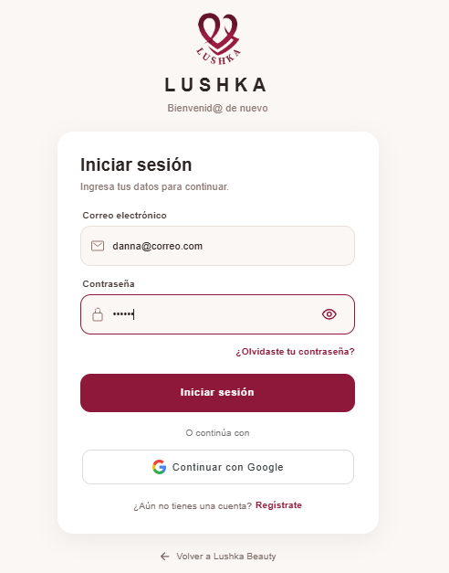
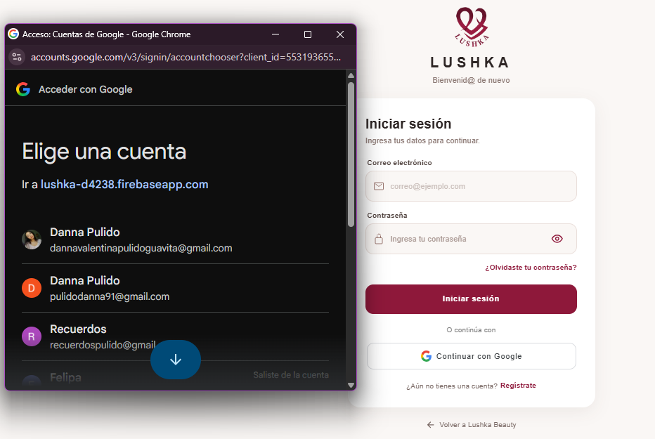
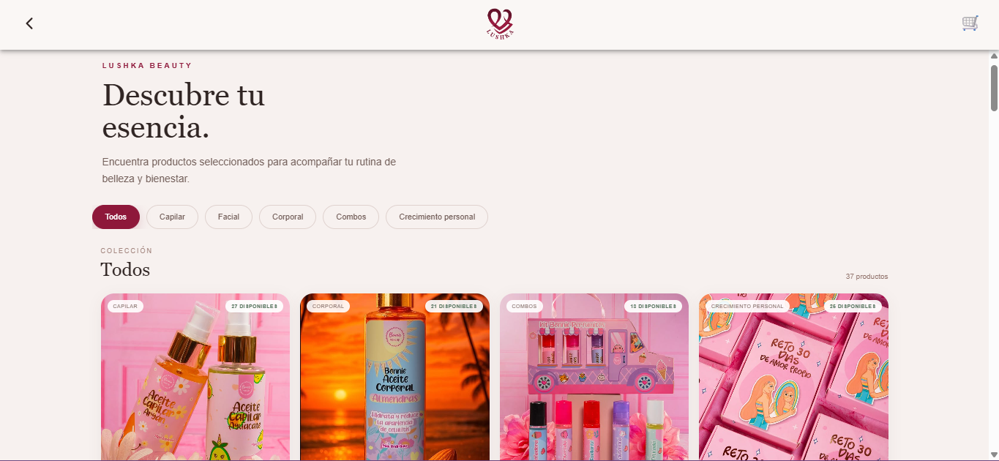
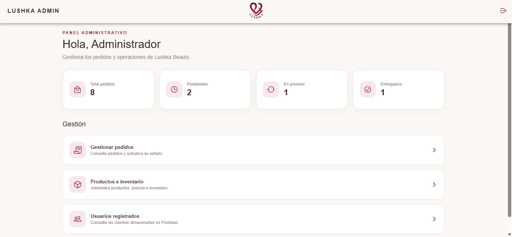
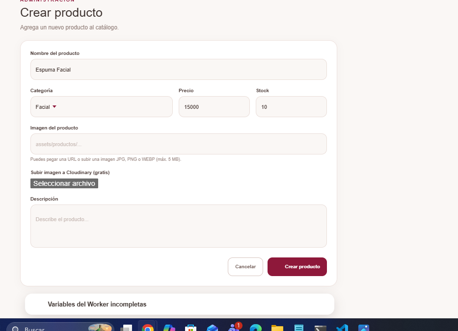
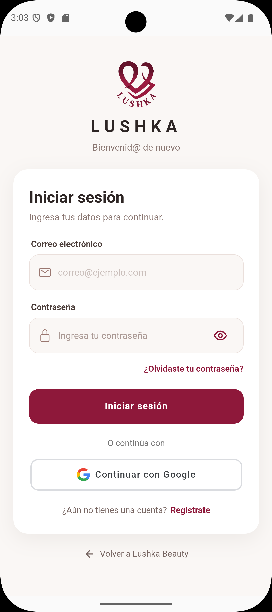
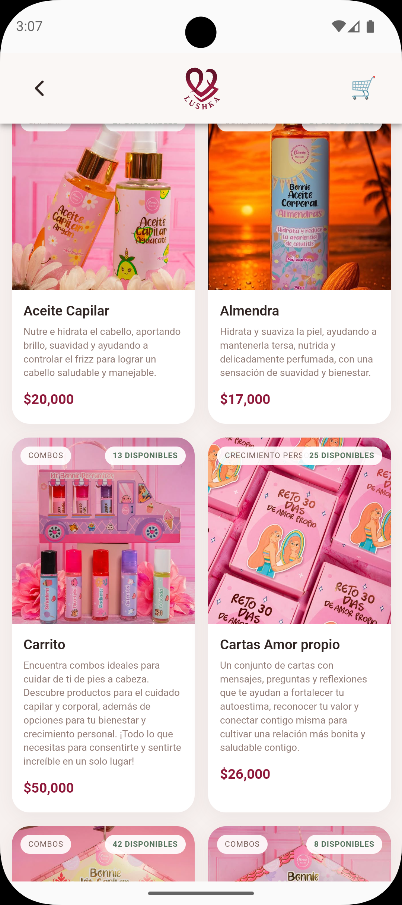
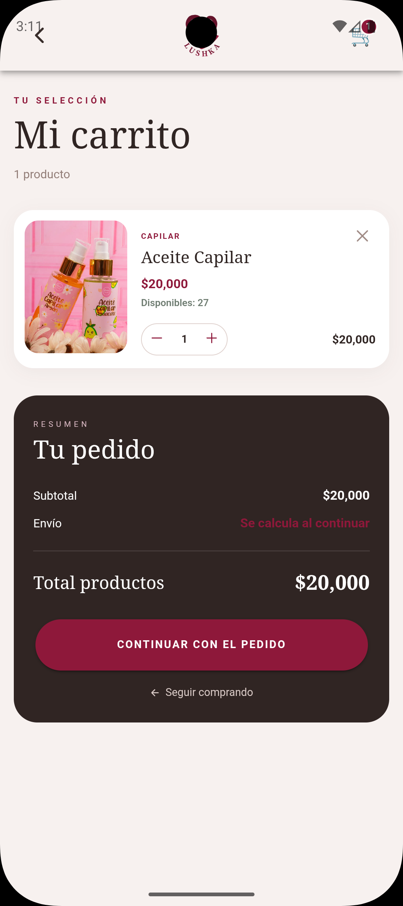
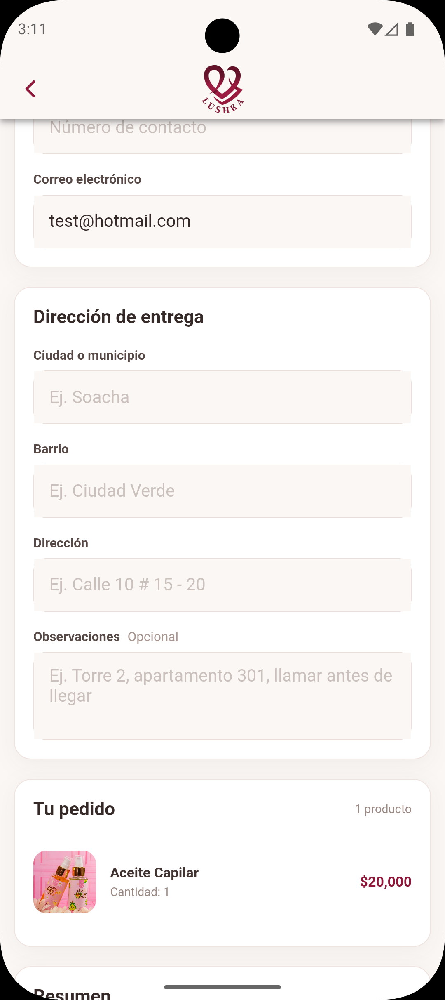
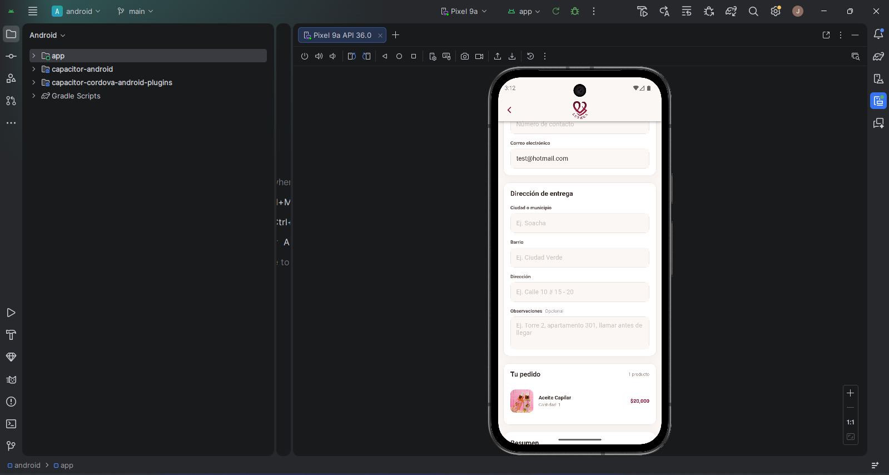

# Lushka Beauty 💄

### Aplicación híbrida para la comercialización y gestión de productos de belleza

<p align="center">
  
</p>

<p align="center">
  <strong>Proyecto integrador · Desarrollo de Aplicaciones Móviles Híbridas</strong><br>
  Fundación Universitaria Compensar · Ingeniería de Software · Corte 3
</p>

> 🎥 **Video demostrativo (entrega final):** pendiente de agregar la URL pública de la sustentación. Al publicarlo, sustituir este aviso por un enlace verificable a YouTube, Loom o Drive con acceso de lectura para el evaluador.
>
> 💻 **Repositorio:** [Johan140726/LushkaBeauty](https://github.com/Johan140726/LushkaBeauty)

## 1. Descripción y alcance

**Lushka Beauty** es una aplicación híbrida de comercio electrónico para explorar productos de belleza, registrarse, iniciar sesión, administrar un carrito, generar solicitudes de pedido y consultar su estado. Su módulo administrativo permite gestionar el catálogo, las fotografías, los usuarios, las existencias y los estados de los pedidos.

La solución utiliza **Ionic, Angular, TypeScript y Capacitor** para compartir el código de interfaz entre **Web y Android**. La información de negocio se conserva en **Cloud Firestore**, la autenticación se realiza con **Firebase Authentication**, las imágenes se almacenan en **Cloudinary** y las cargas se autorizan mediante un servicio de **Cloudflare Workers**.

**Alcance actual:** se registran solicitudes de pedido; no se implementa una pasarela de cobro electrónico. El stock se verifica y descuenta al confirmar un pedido, y se devuelve al cancelarlo cuando corresponde. Los pedidos pendientes no reservan inventario.

## 2. Objetivos

**General.** Desarrollar una tienda híbrida que facilite la compra de productos de belleza y permita gestionar centralizadamente catálogo, inventario y pedidos.

**Específicos.** Diseñar vistas adaptables para Web y Android; implementar autenticación y permisos; almacenar datos en Firestore; ofrecer operaciones CRUD de productos; gestionar el carrito y los pedidos; integrar un servicio externo para fotografías; y compilar la aplicación para Android con Capacitor.

## 3. Equipo

- **Johan Stivens Rojas Lozano**
- **Leidy Vanessa Zambrano Bogoya**
- **Danna Valentina Pulido Guavita**

.

## 4. Tecnologías

| Tecnología | Uso en Lushka Beauty |
|---|---|
| Ionic Framework + Angular | Interfaz híbrida, navegación, formularios y vistas |
| TypeScript, HTML y SCSS | Lógica, estructura y estilos |
| Capacitor + Android Studio | Empaquetado, sincronización y ejecución en Android |
| Firebase Authentication | Registro, acceso por correo/contraseña y proveedor de Google en Web |
| Firebase ID tokens (JWT) | Credenciales de sesión firmadas, usadas también para autorizar el servicio de imágenes |
| Cloud Firestore | Datos persistentes: usuarios, productos, carritos y pedidos |
| Cloudflare Workers | API HTTP que autoriza la carga de imágenes |
| Cloudinary | Almacenamiento, entrega y URLs HTTPS de las fotografías |
| Git y GitHub | Versionamiento e historial de colaboración |

## 5. Funcionalidades

### Cliente

- Registro e inicio de sesión con correo y contraseña; inicio de sesión con Google en la **versión web**.
- Catálogo por categorías, fichas y fotografías de productos.
- Carrito por usuario guardado en Firestore.
- Formulario de entrega, cálculo de subtotal y envío, y creación de solicitudes de pedido.
- Historial personal y seguimiento del estado de cada pedido.

### Administrador

- Acceso a rutas y operaciones administrativas restringidas.
- CRUD de productos: **crear, consultar, actualizar y eliminar**.
- Carga de imágenes a Cloudinary mediante el Worker.
- Consulta de perfiles de usuario y pedidos.
- Cambio de estados; actualización de existencias con transacciones para evitar aplicar dos veces el mismo descuento o devolución.

## 6. Evidencias visuales · Web

Las siguientes imágenes muestran vistas del proyecto en navegador.

### 6.1 Inicio de sesión y acceso con Google

<p align="center">
  
  
</p>

### 6.2 Catálogo

<p align="center">
  
</p>

### 6.3 Panel administrativo y formulario de productos

<p align="center">
  
  
</p>

## 7. Evidencias visuales · Android (Capacitor)

Estas capturas documentan las interfaces de Lushka Beauty dentro del entorno Android. Se deben conservar los archivos PNG dentro de **`docs/evidencias/android/`** con estos mismos nombres, para que las imágenes se visualicen en GitHub.

### 7.1 Inicio de sesión Android

<p align="center"></p>

### 7.2 Catálogo de productos Android

<p align="center"></p>

### 7.3 Carrito de compras Android

<p align="center"></p>

### 7.4 Historial de pedidos Android

<p align="center"></p>

### 7.5 Ejecución en Android Studio

<p align="center"></p>


## 8. Arquitectura y persistencia

```text
                  LUSHKA BEAUTY
             Ionic + Angular + Capacitor
                         |
              Servicios de la aplicación
                 /          |          \
      Firebase Auth     Firestore    Cloudflare Worker
      (identidad)       (datos)        (autorización)
                                          |
                                      Cloudinary
                                      (imágenes)
```

**Colecciones principales de Firestore:**

| Colección | Datos que mantiene |
|---|---|
| `usuarios` | Perfil, correo y rol visible del usuario |
| `productos` | Nombre, precio, categoría, foto y stock |
| `carritos` | Productos y cantidades por UID |
| `pedidos` | Datos de entrega, productos, totales y estado |

Los datos de Firestore se sincronizan entre las vistas de cliente y administrador. **Las fotos no se almacenan dentro de Firestore**: se guarda su URL de Cloudinary como campo del producto.

## 9. Consumo de APIs externas y servicios de terceros

Esta integración es parte de la lógica de negocio: permite identificar usuarios, controlar el acceso a las imágenes y servir fotografías al catálogo.

### 9.1 Cloudflare Workers · API propia de integración

Se implementó una API HTTP desplegada en Cloudflare Workers:

**Base:** `https://lushka-imagenes-api.josrojaslouni.workers.dev`

| Método | Endpoint | Uso |
|---|---|---|
| `GET` | `/health` | Comprueba que el Worker está operativo |
| `POST` | `/upload` | Recibe un archivo y un token Firebase; autoriza la carga y lo envía a Cloudinary |

El formulario administrativo envía una solicitud `POST /upload` con el **ID token JWT de Firebase** en `Authorization: Bearer <token>` y la imagen en `multipart/form-data`. El Worker verifica criptográficamente el token, su proyecto emisor y el permiso personalizado `admin: true`. Cuando está autorizado, firma la solicitud con las credenciales privadas conservadas en Cloudflare y comunica la carga a Cloudinary. Se admiten JPG, PNG o WebP de hasta **5 MB**.

Una respuesta exitosa devuelve la **URL HTTPS** y el identificador de la imagen. La aplicación usa esa URL en el documento del producto almacenado en Firestore.

### 9.2 Cloudinary · API de subida y entrega de recursos

Cloudinary es un **servicio externo de gestión de medios** utilizado para subir, almacenar y distribuir las fotografías. El Worker consume su endpoint de carga de imágenes; las vistas de catálogo consultan las URL públicas HTTPS devueltas por Cloudinary.

**Beneficio:** desacoplar las imágenes del almacenamiento de Firestore y disponer de recursos accesibles desde Web y Android. Se utiliza el preset firmado `lushka_productos`.

### 9.3 Firebase Authentication y Firestore · SDK y servicios en la nube

La aplicación integra los **SDK de Firebase** para registro, autenticación, lectura y escritura de documentos. Firebase Authentication emite tokens ID en formato JWT, que se pueden verificar en el servidor; Firestore almacena el catálogo y el estado de los pedidos. El acceso con Google se integra como proveedor externo de identidad en la versión web.


### 9.4 Flujo de carga de imágenes

```text
Administrador autenticado
   -> selecciona imagen (hasta 5 MB)
   -> Ionic envía ID token + archivo a Cloudflare POST /upload
   -> Worker valida JWT y claim admin:true
   -> Worker firma y llama a Cloudinary
   -> Cloudinary devuelve secure_url
   -> Firestore guarda la URL en el producto
   -> el catálogo muestra la imagen en Web / Android
```

**Seguridad:** `CLOUDINARY_API_SECRET` se conserva como **Secret** en Cloudflare. No se debe copiar a Angular, al README ni al repositorio. El rol `admin` mostrado en un documento no reemplaza el custom claim firmado.

## 10. Autenticación, sesión y autorización

- **Autenticación:** Firebase Authentication gestiona las credenciales e inicia sesión mediante correo/contraseña y Google (Web).
- **JWT:** los ID tokens de Firebase se utilizan en solicitudes autenticadas, especialmente para validar el acceso al Worker.
- **Rutas privadas:** un guard de Angular protege la navegación administrativa.
- **Reglas de Firestore:** controlan lectura y escritura aunque alguien intente omitir el guard o manipular la interfaz.
- **Cierre de sesión:** la aplicación debe terminar la sesión mediante el SDK de Firebase y limpiar cualquier estado sensible adicional que haya guardado localmente.
- **Persistencia:** Firebase puede conservar el estado de autenticación según la plataforma y configuración. **No se afirma el uso de Capacitor Preferences/Storage ni limpieza manual de tokens sin comprobar el código**. Este punto debe verificarse expresamente para el criterio del Corte 3.

## 11. Pedidos e inventario

1. El cliente prepara su carrito y solicita un pedido.
2. Firestore lo registra inicialmente como **Pendiente**.
3. El administrador revisa el pedido y lo confirma.
4. Una transacción valida la disponibilidad y descuenta las unidades; evita un descuento duplicado.
5. Si el pedido confirmado se cancela y ya tenía stock descontado, la transacción devuelve las unidades una sola vez.

**Límites funcionales:** no hay cobro en línea ni reserva anticipada del inventario mientras el pedido permanece Pendiente.

## 12. Instalación, ejecución Web y Android

**Requisitos:** Node.js y npm, Git, Android Studio con SDK de Android para pruebas nativas, y acceso a los servicios configurados.

### Clonar e instalar

```bash
git clone https://github.com/Johan140726/LushkaBeauty.git
cd LushkaBeauty
npm install
```

### Ejecutar en navegador

```bash
npx ionic serve
```

La URL local se muestra en la terminal (habitualmente `http://localhost:8100`).

### Compilar y sincronizar con Android

```bash
npm run build
npx cap sync android
npx cap open android
```

En Android Studio, seleccionar `app`, el emulador o el teléfono conectado y ejecutar con **Run**. **No volver a ejecutar `npx cap add android`** cuando la carpeta `android/` ya existe.

### APK de depuración (opcional)

Desde la raíz del proyecto, en PowerShell:

```powershell
cd android
.\gradlew.bat assembleDebug
```

El APK de prueba se genera normalmente en `android/app/build/outputs/apk/debug/app-debug.apk`. Para publicar una versión definitiva se requiere un APK o AAB de release firmado.

> Si se modifica el código Web, ejecutar otra vez `npm run build` y `npx cap sync android` antes de generar el APK.

## 13. Pruebas y evidencias de validación

| Flujo | Evidencia disponible / validación |
|---|---|
| Registro e inicio de sesión por correo | Probado en Web; capturas de Login |
| Login con Google | Captura de flujo Web; validar por separado en Android |
| CRUD del catálogo | Pruebas de crear, actualizar, consultar y eliminar productos |
| Carga de imágenes | Worker + Cloudinary + URL guardada en Firestore |
| Carrito | Documento persistente por UID en Firestore |
| Pedido | Documento creado y visible para cliente y administrador |
| Estados de pedido | Cambio de estado visible en ambas vistas |
| Inventario | Descuento al confirmar y devolución al cancelar comprobados durante pruebas |
| Ejecución nativa | Capturas en `docs/evidencias/android/` y Android Studio |

Scripts disponibles según la configuración del repositorio:

```bash
npm run test:static
npm run test:worker
npm run test:inventory
npm run test:ui
npm run lint:ts
```

Los comandos y sus resultados deben verificarse en el entorno donde se presenta la solución.

## 14. Estructura relevante del repositorio

```text
LushkaBeauty/
├── android/                      # Proyecto nativo Capacitor
├── cloudflare-worker/            # Servicio de imágenes
├── docs/
│   └── evidencias/
│       ├── pantallaLoginContraseña.png
│       ├── PantallaGoogle.png
│       ├── pantallaCatalogo.png
│       ├── pantallaAdmin.png
│       ├── formulario-crear.png
│       └── android/
│           ├── login-android.png
│           ├── catalogo-android.png
│           ├── carrito-android.png
│           ├── pedidos-android.png
│           └── android-studio.png
├── scripts/                      # Utilidades y verificación
├── tests/                        # Pruebas automatizadas
├── src/
│   ├── app/                      # Páginas, servicios y guards
│   └── assets/                   # Recursos de interfaz
├── firestore.rules               # Reglas del proyecto
├── capacitor.config.ts
├── package.json
└── README.md
```

**Fundación Universitaria Compensar · Ingeniería de Software · Desarrollo de Aplicaciones Móviles Híbridas**
