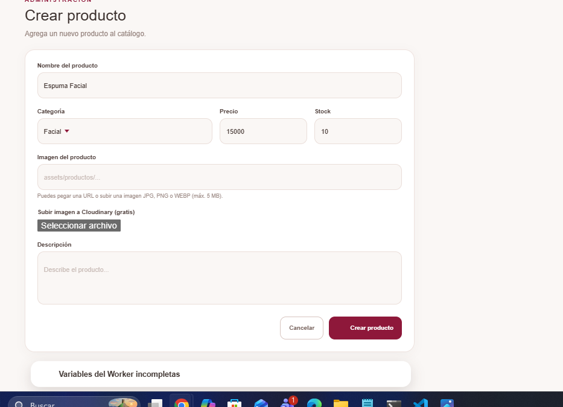
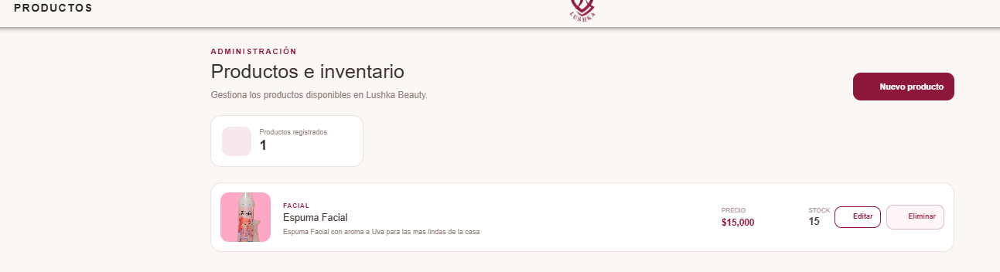
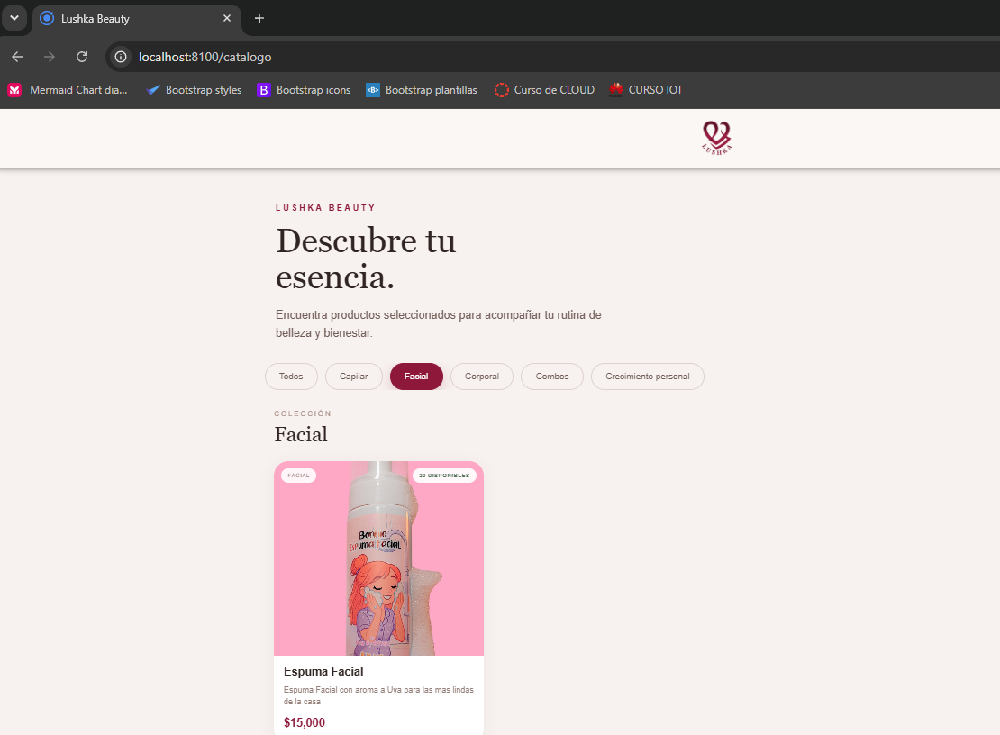
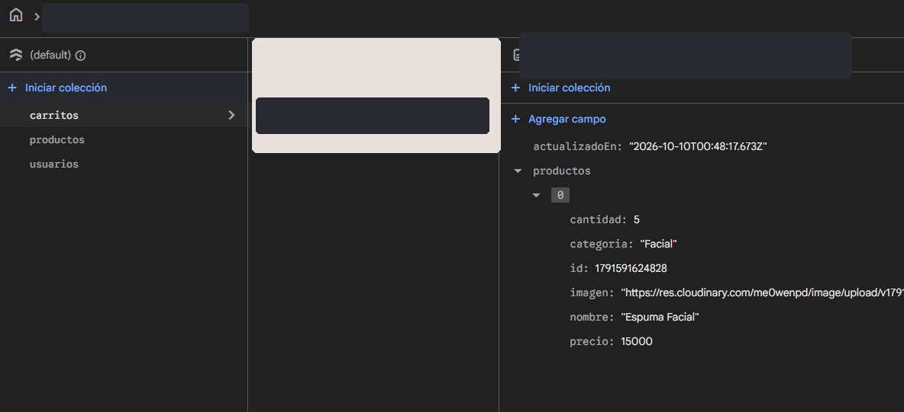
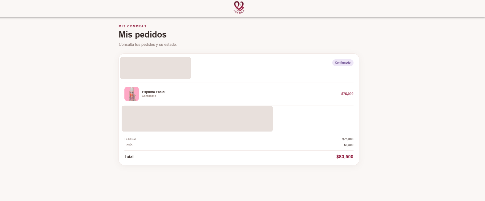
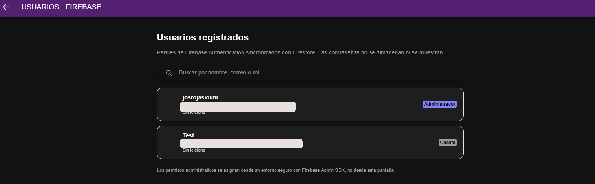

# Lushka Beauty · Tienda híbrida con Firebase y Cloudinary

**Versión 2.1.0 · Ionic + Angular · Corte 2 — Desarrollo de Aplicaciones Móviles Híbridas**

Aplicación de catálogo y gestión de pedidos de belleza. Los clientes pueden registrarse, consultar productos, mantener su carrito y realizar solicitudes de compra. El administrador puede gestionar productos, imágenes, usuarios, pedidos e inventario.

> **Estado de esta entrega:** se actualizaron el aspecto de la pantalla de usuarios, el tema claro y el registro de los iconos de Ionic. Los flujos del proyecto anterior se preservaron. Las capturas de las pruebas funcionales corresponden a las ejecuciones realizadas por el usuario antes de este cambio visual; el aspecto renovado debe verificarse tras iniciarlo.

## 1. Resumen técnico

| Capa | Herramienta / función |
|---|---|
| Interfaz | Ionic 8 + Angular 20 + TypeScript + SCSS |
| Autenticación | Firebase Authentication (email/contraseña) |
| Persistencia | Cloud Firestore (colecciones NoSQL) |
| Imágenes | Cloudinary, preset firmado `lushka_productos` |
| API de imágenes | Cloudflare Worker que verifica `admin: true` antes de subir |
| Autorización | Custom claims de Firebase, Guards de rutas y reglas de Firestore |
| Inventario | Transacciones Firestore al confirmar/cancelar pedidos |
| Pruebas locales | `npm run test:static`, `npm run test:worker`, `npm run test:inventory`, `npm run test:ui` |

El proyecto está configurado con estos **identificadores públicos**:

- **Proyecto Firebase:** `lushka-d4238`
- **Cloudinary Cloud Name:** `me0wenpd`
- **URL del Worker:** `https://lushka-imagenes-api.josrojaslouni.workers.dev`
- **Ruta Firebase principal:** base de datos `(default)`

Las API Keys web de Firebase sirven para identificar el proyecto, **no** sustituyen las reglas de autorización. El **API Secret de Cloudinary** y las contraseñas **no** se incluyen en el repositorio.

## 2. Instalación y ejecución paso a paso

Requisitos: Windows/macOS/Linux, Node.js 22 LTS recomendado, npm, Visual Studio Code, conexión a Internet y servicios externos ya configurados.

1. Extraer el ZIP y **abrir `LushkaBeauty_Firebase`**, la carpeta que contiene `package.json`.
2. En una terminal de Visual Studio Code ejecutar:

   ```bash
   npm install
   npx ionic serve
   ```

3. Abrir `http://localhost:8100` (dirección habitual mostrada por Ionic).
4. Iniciar sesión con las cuentas **ya registradas** en Firebase Authentication; no hace falta volver a crear usuarios ni productos.
5. Como administrador visitar `/admin` y después `/admin-usuarios` para comprobar la nueva interfaz.

**No vuelvas a desplegar reglas, regenerar claves, crear una base de datos ni cambiar el Worker solamente por instalar este ZIP.** Conserva el Firebase, el Worker y las reglas que ya probaste. Si se publica este proyecto en otro Firebase, sí será necesario reconfigurar las credenciales y desplegar reglas adecuadas.

> Si abres la carpeta padre (donde no está `package.json`), `npm install` no se ejecutará sobre la app. Comprueba la ruta con `dir package.json` (PowerShell).

## 3. Arquitectura y flujo de información

```text
Cliente / Administrador — Ionic Angular
             |
      Firebase Authentication
             | (token Firebase con UID y, para admin, custom claim admin:true)
             +--------> Firestore: usuarios, productos, carritos, pedidos
             |              ^
             |      Reglas + transacciones de inventario
             |
             +--------> Cloudflare Worker /upload (solo admin autenticado)
                              |
                         Cloudinary
                              |
                      URL HTTPS de imagen
                              |
                     Firestore/productos
```

Los registros de usuarios se almacenan en `usuarios/{uid}` sin contraseñas (las contraseñas son gestionadas por Firebase Authentication). El campo visible `rol` sirve para la interfaz; los permisos administrativos reales se comprueban mediante `request.auth.token.get('admin', false)`.

## 4. Pantallas y rutas relevantes

| Ruta | Función | Acceso |
|---|---|---|
| `/home` | Portada e inicio | Público |
| `/catalogo` | Catálogo y categorías | Público |
| `/producto/:id` | Detalle de producto | Público |
| `/login` y `/registro` | Inicio de sesión y creación de cuentas | Público |
| `/carrito` | Carrito; requiere cuenta para guardar cambios | Cliente autenticado para operar |
| `/checkout` | Solicitud de compra | Autenticado |
| `/mis-pedidos` y `/mi-cuenta` | Historial y perfil | Autenticado |
| `/admin` | Resumen administrativo | Administrador |
| `/admin-productos` | Consultar/eliminar productos | Administrador |
| `/admin-producto/nuevo` | Crear producto y subir fotografía | Administrador |
| `/admin-producto/editar/:id` | Editar precio/stock/descripción | Administrador |
| `/admin-pedidos` | Consultar estados y mover inventario | Administrador |
| `/admin-usuarios` | Perfiles y filtro por nombre/correo/rol | Administrador |

Las rutas privilegiadas están protegidas por `AdminGuard`; el **servidor Firestore** vuelve a validar permisos independientemente del navegador.

## 5. Esquema de Firestore (NoSQL)

| Colección/documento | Campos principales | Lectura/escritura |
|---|---|---|
| `usuarios/{uid}` | `nombre`, `correo`, `telefono`, `rol`, `creadoEn` | Dueño consulta/edita datos permitidos; admin consulta perfiles |
| `productos/{id}` | `id`, `nombre`, `categoria`, `descripcion`, `precio`, `stock`, `imagen` | Público lee, administrador ejecuta CRUD |
| `carritos/{uid}` | `productos[]`, `actualizadoEn` | Solo el usuario dueño |
| `pedidos/{id}` | `usuarioId`, contacto, entrega, `productos[]`, `subtotal`, `envio`, `total`, `fecha`, `estado`, `stockDevuelto`, `inventarioDescontado` | Cliente crea y consulta los suyos; admin consulta y actualiza estado/inventario |

Las colecciones se generan a partir de la primera escritura autorizada. No son tablas SQL. Reglas desplegables: `firestore.rules`; copia legible: `REGLAS_FIRESTORE_PARA_PEGAR.txt`.

**CRUD de productos (módulo `src/app/services/productos.ts`):** `crearProducto`, `cargarProductos`/`cargarProducto`, `actualizarProducto`, `eliminarProducto`. El panel presenta mensajes, indicadores condicionales, vistas vacías, controles de carga y estados de inventario.

**Inventario transaccional (servicios `pedidos.ts` e `inventario.ts`):**
- **Pendiente → Confirmado:** valida stock actual y lo descuenta una sola vez dentro de una transacción.
- **Confirmado → estados de preparación/entrega:** no repite el descuento.
- **Pedido con stock descontado → Cancelado:** reintegra las unidades una sola vez.
- **Pedidos antiguos:** regularización explícita; no presionar si ya se modificó el stock manualmente.
- Las solicitudes Pendientes **no reservan** unidades. Si faltan existencias al confirmar, se impide la confirmación.

> Este flujo es para fines académicos y **no procesa cobros reales**. Para producción haría falta mayor control de inventario, pagos, auditoría y protección contra manipulación de datos en un backend confiable.

## 6. API HTTP y servicios asíncronos

La interfaz usa **Firebase SDK** para Authentication y Firestore; esas llamadas no son endpoints REST implementados por el proyecto. Para subir imágenes sí existe esta API HTTP:

| Método y ruta | Acceso | Petición | Respuesta principal |
|---|---|---|---|
| `GET /health` | Público | Sin cuerpo | `200 {"ok":true,"servicio":"Lushka Imágenes"}` |
| `POST /upload` | Firebase ID token con claim admin | `Authorization: Bearer <ID_TOKEN>` + `multipart/form-data`, campo `file` | `200 {"ok":true,"url":"https://...","publicId":"..."}` |

Posibles errores de `/upload`: **400** archivo inválido o tipo no admitido, **401** sesión ausente/inválida, **403** no administrador/origen no permitido, **413** tamaño excesivo, **500** variables ausentes y **502** error del proveedor de imágenes. Acepta JPG, PNG o WebP de hasta 5 MB.

Código fuente: `cloudflare-worker/lushka-imagenes-api.worker.js`. Variables requeridas **en Cloudflare Production**:

```text
CLOUDINARY_CLOUD_NAME   = me0wenpd
CLOUDINARY_API_KEY      = [guardar en Cloudflare]
CLOUDINARY_API_SECRET   = [guardar como Secret en Cloudflare]
FIREBASE_PROJECT_ID     = lushka-d4238
```

**Nunca** colocar `CLOUDINARY_API_SECRET` en Angular, README público o Firestore. Si se muestra accidentalmente en una captura, rotar la clave en Cloudinary y actualizar el Secret en Cloudflare.

## 7. Interfaces reactivas, accesibilidad y mejoras visuales

- Se unificó `/admin-usuarios` con los tonos **crema `#faf7f5` y vinotinto `#8e183a`**, encabezado, logo, tarjetas y buscador del resto del proyecto.
- Se evita el cambio automático al tema oscuro que provocaba fondo negro en la pantalla de usuarios.
- Se registran explícitamente los íconos de Ionicons en `src/app/app.component.ts`, evitando contenedores de iconos vacíos.
- Se añadieron estados de carga, contador de usuarios, mensajes de resultados vacíos, insignias de roles y diseño responsive para móviles.
- Las tarjetas del administrador permiten navegación mediante teclado (`Tab`, `Enter`, `Espacio`) además de ratón.
- Los formularios y listados utilizan clases dinámicas según estado, como producto agotado o rol de usuario, y retroalimentación con componentes de Ionic.

## 8. Evidencias visuales del proyecto

Las siguientes capturas corresponden a las **pruebas reales del proyecto anterior realizadas en la conversación**. Se ocultan datos personales en algunas. No son una simulación de la versión visual actualizada.

**Crear producto** (nombre, categoría, stock e imagen):



**Consultar y actualizar inventario** (stock modificado tras operación):



**Consultar catálogo público:**



**Persistencia del carrito en Firestore:**



**Pedido y estado visible al cliente:**



**Consulta de usuarios por rol** (interfaz anterior, antes de unificación):



**Prueba de eliminación:** se creó un producto temporal, luego se eliminó y el listado regresó a un producto. El flujo fue verificado durante las pruebas guiadas; una captura de confirmación del botón eliminar no se aportó.

## 9. Evidencias y resultado de pruebas

| Prueba | Resultado observado durante la ejecución guiada |
|---|---|
| Registro e ingreso en Firebase | Usuario cliente creado y acceso posterior logrado |
| Panel de administración | Acceso con custom claim `admin: true` |
| Crear, consultar, editar y eliminar productos | Operaciones verificadas en la aplicación |
| Subida de imagen a Cloudinary | Imagen visible en catálogo y panel |
| Catálogo público | Producto visible desde ventana privada |
| Carrito | Documento observado en Firestore y conservado tras recargar |
| Pedido | Solicitud guardada en `pedidos`, visible en cliente y admin |
| Estado de pedido | Cliente visualizó `Confirmado` tras cambio admin |
| Inventario al confirmar | Stock bajó de 20 a 15 |
| Inventario al cancelar | Stock volvió de 15 a 20 |
| Pantalla usuarios | Dos perfiles visibles con rol admin/cliente |
| Nueva interfaz visual e iconos | **Pendiente de verificar en el equipo tras instalar este ZIP** |

Para las evidencias de corrección de íconos y el nuevo tema agrega una captura después de ejecutar la versión actualizada. Si la entrega requiere GIF de edición/eliminación, grábalo desde el equipo durante una nueva prueba con producto temporal.

## 10. Comandos de verificación local

```bash
npm run test:static
npm run test:worker
npm run test:inventory
npm run test:ui
npm run build
```

- `test:static`: comprueba la sintaxis/consistencia de archivos y catálogo inicial.
- `test:worker`: pruebas simuladas de autenticación/firma (no sube a Cloudinary real).
- `test:inventory`: simulaciones de transacciones y estados.
- `test:ui`: verifica que todos los nombres de iconos en plantillas estén registrados, estilo claro y evidencias existentes.
- `npm run build`: **compilación de Angular real**, exige `npm install` y no puede sustituirse por una prueba estática.

## 11. Estructura principal

```text
LushkaBeauty_Firebase/
├── src/
│   ├── app/
│   │   ├── admin/                 # Resumen administrativo
│   │   ├── admin-usuarios/        # Vista unificada de perfiles
│   │   ├── admin-productos/       # Listado de catálogo
│   │   ├── admin-producto-form/   # Crear y actualizar
│   │   ├── admin-pedidos/         # Pedidos + estados
│   │   ├── login/ registro/       # Authentication
│   │   ├── catalogo/ carrito/     # Tienda
│   │   ├── checkout/ mis-pedidos/ # Compra e historial
│   │   ├── guards/                # SesionGuard / AdminGuard
│   │   └── services/              # auth, productos, carrito, pedidos, inventario, firebase
│   ├── environments/              # Configuración pública
│   └── assets/                    # Logotipo y catálogo original
├── cloudflare-worker/             # Endpoint seguro de imágenes
├── docs/evidencias/              # Capturas reales con datos parcialmente ocultos
├── tests/                        # Simulaciones y tests de integridad
├── scripts/                      # Verificación y herramientas adicionales
├── firestore.rules               # Reglas de acceso
├── LEER_PRIMERO.txt               # Inicio rápido
├── README.md
└── package.json
```

## 12. Requisitos del Corte 2 y colaboración

La actividad **Corte 2 — Proyecto integrador: desarrollo de producto, CRUD y persistencia** evalúa código funcional (**60 %**) y documentación técnica en README (**40 %**). Los requisitos se abordan mediante servicios asíncronos, CRUD Firestore, clases reactivas, retroalimentación Ionic, descripción de arquitectura y evidencias visuales. Ver además `docs/ENTREGA_CORTE_2.md`.

Para la entrega académica, completar antes de presentar: **integrantes y roles del equipo** (máximo 3), **enlace del repositorio** y evidencias verificables de **commits Git de cada integrante**, ya que estos datos no se pueden inferir de los archivos aportados.

## 13. Aspectos pendientes y precauciones

- Las reglas de Firestore **deben permanecer publicadas** en el Firebase real y la clave privada debe seguir guardada como Secret en Cloudflare; instalar ZIP nuevo no cambia estos servicios.
- La pantalla nueva y el conjunto de iconos registrados **necesitan prueba final en Windows con `ionic serve`**. Los servicios de terceros no son accesibles de extremo a extremo desde el entorno de preparación.
- No publicar capturas que incluyan contraseñas, secretos o direcciones/teléfonos reales de clientes.
- No hay cobro electrónico integrado; las compras son solicitudes. Puede haber cambios de stock mientras un pedido está pendiente.
- Si se despliega a un dominio público, agregar el origen a `ALLOWED_ORIGINS` del Worker y probar CORS.
- Para una aplicación comercial real, revisar transacciones, auditoría, restricciones antiabuso y cumplimiento de datos personales.
